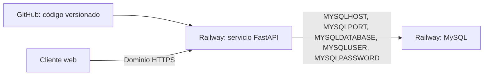

# Urban Sneakers
Sistema de información para Urban Sneakers. El backend usa FastAPI y MySQL; permite consultar el catálogo, registrar clientes, iniciar sesión, administrar categorías e inventario, registrar pedidos, actualizar su estado y consultar reportes de ventas. Las páginas, estilos, scripts e imágenes se sirven desde FastAPI para que el sitio y la API compartan el mismo dominio.

## Ejecutar en el computador

Requisitos: Python 3.10 o superior y MySQL.

1. Cree una base de datos vacía llamada `urban_sneakers1`.
2. Ejecute `database/schema.sql` en esa base. El archivo crea las tablas y agrega categorías y productos de muestra.
3. Copie `.env.example` a `.env` y escriba los datos de conexión locales. En PowerShell puede usar `Copy-Item .env.example .env`. No suba `.env` a GitHub.
4. Desde la carpeta principal del proyecto, instale dependencias y ejecute:

   ```powershell
   python -m venv .venv
   .\.venv\Scripts\python.exe -m pip install -r requirements.txt
   .\.venv\Scripts\python.exe -m uvicorn app.main:app --app-dir backend --reload
   ```

   También puede iniciar desde `backend` con `uvicorn app.main:app --reload`.
5. Abra `http://127.0.0.1:8000/`. La documentación de la API está en `/docs` y el estado del servicio en `/health`.
6. Cree una cuenta desde la tienda. Para usar las páginas administrativas localmente, asígnele el rol con `UPDATE usuarios SET rol='administrador' WHERE email='correo-del-aprendiz';` desde su cliente MySQL; cierre e inicie sesión otra vez para que la sesión tome el nuevo rol.

La conexión de base de datos admite las variables de Railway `MYSQLHOST`, `MYSQLPORT`, `MYSQLDATABASE`, `MYSQLUSER` y `MYSQLPASSWORD`. Para desarrollo local también acepta `DB_HOST`, `DB_PORT`, `DB_NAME`, `DB_USER` y `DB_PASSWORD`. Si se definen ambas familias, se usan primero las variables `MYSQL*`.

## Publicar con Railway

1. Publique el código fuente en su repositorio de GitHub. El `.gitignore` excluye entornos virtuales, archivos `.env` y los respaldos SQL originales.
2. En Railway cree un proyecto y despliegue el repositorio como servicio web. El archivo `requirements.txt` de la raíz instala las dependencias de `backend/requirements.txt`.
3. Añada un servicio MySQL. En el servicio web configure variables referenciadas a las credenciales del servicio MySQL con estos nombres: `MYSQLHOST`, `MYSQLPORT`, `MYSQLDATABASE`, `MYSQLUSER` y `MYSQLPASSWORD`.
4. En el servicio web use este comando de inicio:

   ```sh
   cd backend && uvicorn app.main:app --host 0.0.0.0 --port $PORT
   ```

5. Cree las tablas en la base MySQL de Railway ejecutando `database/schema.sql` una vez. La base en la nube es independiente de MySQL local.
6. Configure `SESSION_SECRET` con una cadena aleatoria larga y `COOKIE_SECURE=true` en las variables del servicio web.
7. Cree una cuenta desde la tienda. Asígnele el rol de administradora en la consola SQL de Railway con `UPDATE usuarios SET rol='administrador' WHERE email='correo-del-aprendiz';`, y cierre e inicie sesión otra vez.
8. Genere un dominio público en Railway. Revise `/health`, `/docs`, `/api/categorias` y `/api/productos`.
9. Compruebe registro, catálogo, inventario, categorías, pedidos, cambio de estado y reportes. Revise el consumo y los costos vigentes del proveedor.

No se incluyen evidencias de una publicación real: el repositorio de GitHub, las credenciales de Railway, el dominio público y las capturas se deben completar con las cuentas del aprendiz. Nunca escriba credenciales en este archivo ni en las evidencias.

## Archivos importantes

- `backend/app/main.py`: inicia FastAPI, sirve las páginas y define `/health`.
- `backend/app/database.py`: obtiene la conexión mediante variables de entorno.
- `backend/app/routers/categorias.py`: consulta y administra categorías con SQL parametrizado.
- `backend/app/routers/usuarios.py` y `backend/app/routers/auth.py`: registro de clientes y sesión con cookie firmada.
- `backend/app/routers/productos.py`: catálogo, inventario y descuentos.
- `backend/app/routers/pedidos.py`: pedidos, existencias, estados y reportes de ventas.
- `backend/app/routers/contacto.py`: almacenamiento de mensajes de contacto.
- `azure-pipelines.yml`: integración continua y preparación del artefacto.
- `docs/kanban_despliegue.md`: tarjetas para planear la publicación en Trello.
- `database/schema.sql`: esquema limpio para preparar una base nueva, sin datos personales.
- `Procfile`: comando de inicio alternativo para plataformas que lo utilizan.

Los archivos `database/urban_sneakers1.sql` y `database/urban_sneakers1_ultimo.sql` son respaldos locales, no el esquema recomendado para publicar. Contienen registros personales y credenciales de ejemplo inseguros; permanecen excluidos de Git. Si alguno ya se compartió, cambie las contraseñas expuestas y deje de usar esas copias.

## Control de versiones

Desde la carpeta principal, compruebe `git --version`, configure su nombre y correo de GitHub y luego ejecute `git init`, `git add .` y `git commit -m "Prepara Urban Sneakers para despliegue"`. Cree un repositorio vacío en GitHub y conecte la URL HTTPS que le asigne:

```sh
git branch -M main
git remote add origin https://github.com/USUARIO/REPOSITORIO.git
git push -u origin main
```

Reemplace `USUARIO/REPOSITORIO` con su dirección real. Compruebe en GitHub que `.env`, `backend/venv` y los respaldos SQL originales no aparezcan.

## Diagrama y respuestas de despliegue



- GitHub guarda y entrega el código al servicio web durante el despliegue; por sí solo no ejecuta FastAPI ni aloja MySQL.
- La contraseña de MySQL se mantiene como variable privada del servicio porque un valor subido al repositorio puede quedar expuesto en el historial.
- MySQL local y MySQL en Railway son bases distintas. Las tablas y los datos de prueba se deben crear también en la nube.
- `requirements.txt` registra las dependencias Python que Railway debe instalar.
- FastAPI necesita host, puerto, nombre de base, usuario y contraseña para abrir la conexión a MySQL.
- El costo y los límites dependen del plan activo y del consumo en la fecha del despliegue; confírmelos en el panel de Railway antes de publicar y al terminar.

Para la evidencia final de la guía faltan datos que solo existen después de publicar desde las cuentas del aprendiz: nombre de integrantes, enlace real del repositorio, dominio de Railway, capturas de la página y de `/api/categorias`, y consumo observado. Añádalos al informe solicitado por el instructor.
